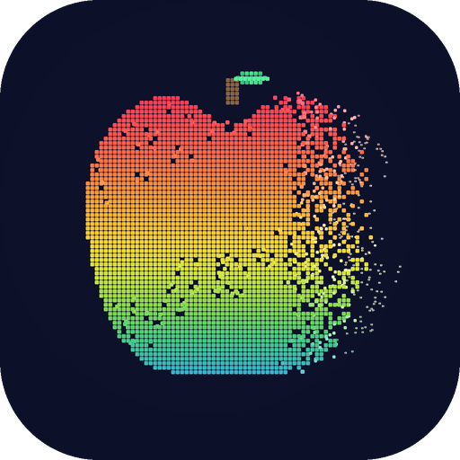
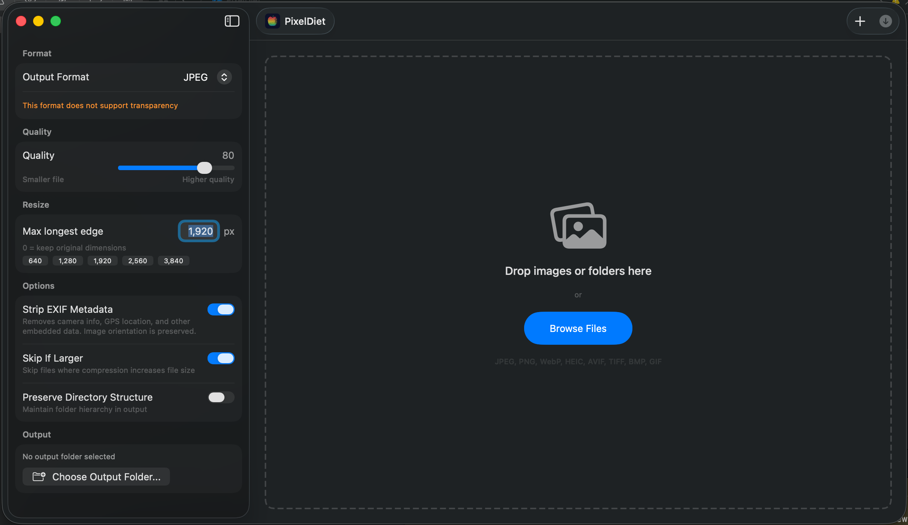
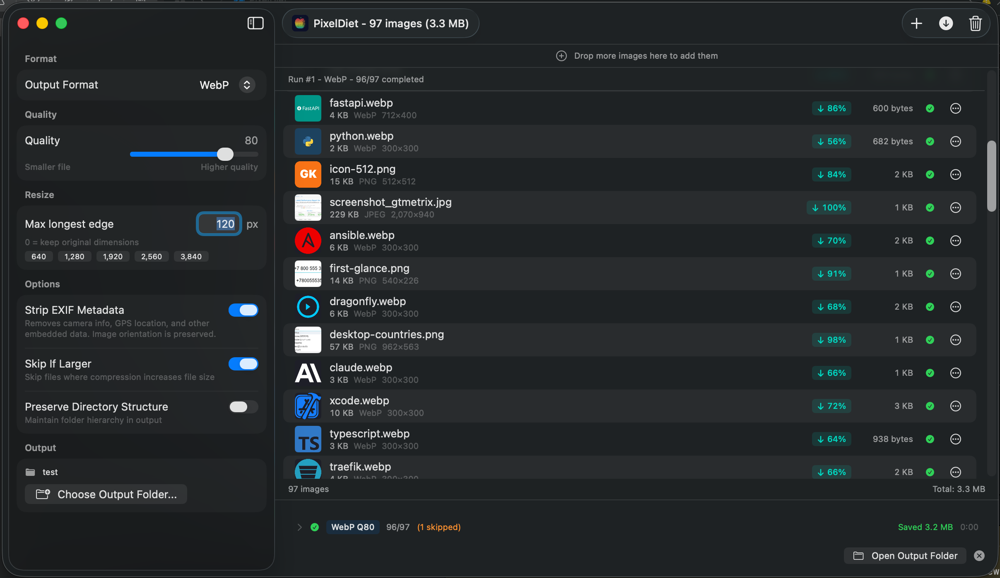
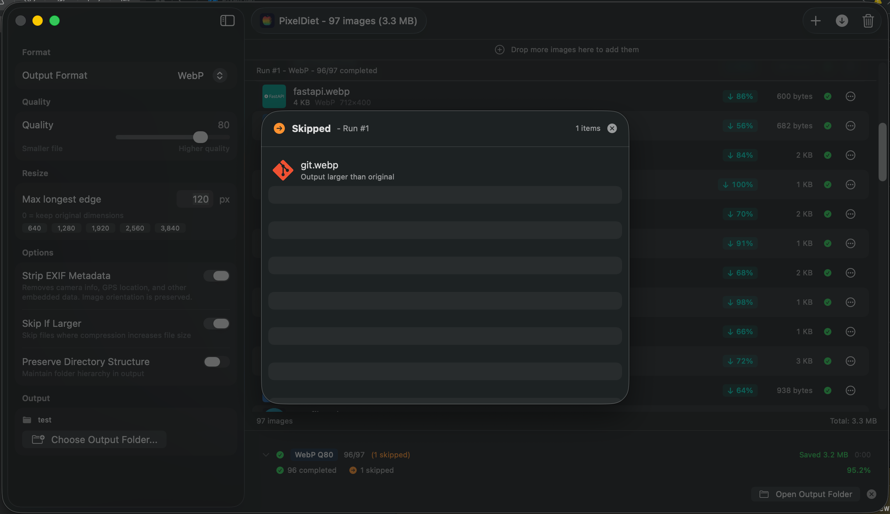

<p align="center">
  
</p>

<h1 align="center">PixelDiet</h1>

<p align="center">
  <strong>Bulk image compression for Mac - fast, native, private.</strong>
</p>

<p align="center">
  
  
  
  
</p>

---

PixelDiet is a native macOS application for batch image compression, resizing, and format conversion. Drop hundreds of images and watch them shrink - using all your CPU cores.

Built entirely with Apple's native frameworks (ImageIO, CoreImage, vImage) plus libwebp for WebP encoding. Zero external dependencies, fully sandboxed, fully offline - your images never leave your Mac.

## Screenshots



*Clean drop zone with format, quality, resize, and metadata controls*



*97 images compressed to WebP with per-file savings and batch stats*



*Smart skip detail - files that would get larger are automatically skipped*

## Features

- **Drag & Drop** - Drop files or folders onto the app window
- **Batch Processing** - Process hundreds of images concurrently across all CPU cores
- **Format Conversion** - Convert between JPEG, PNG, WebP, HEIC, HEIF, AVIF, TIFF, BMP, and GIF
- **11 Input Formats** - PNG, JPEG, WebP, HEIC, HEIF, AVIF, TIFF, BMP, GIF, PPM + extensionless files via content sniffing
- **Quality Control** - Adjustable quality slider (10-100) with format-appropriate encoding
- **Smart Resize** - Max dimension (longest edge) with Lanczos resampling, preserving aspect ratio
- **EXIF Strip** - Remove metadata by default to protect privacy (GPS, camera info)
- **Smart Skip** - Automatically skip files that would get larger after compression
- **Before/After Preview** - Side-by-side comparison with file size savings
- **Conflict Resolution** - Per-file overwrite/rename/skip dialogs with "apply to all"
- **Run History** - Per-run stats with format, quality, elapsed time, and savings breakdown
- **Directory Preservation** - Output mirrors input folder structure
- **Fully Offline** - No network access, no analytics, no tracking

## Requirements

- macOS 14.0 (Sonoma) or later
- Apple Silicon or Intel Mac (Universal Binary)

## Building from Source

1. Clone the repository:
   ```bash
   git clone https://github.com/georgekhananaev/PixelDiet.git
   cd PixelDiet
   ```

2. Open the Xcode project:
   ```bash
   open PixelDiet.xcodeproj
   ```

3. Select the **PixelDiet** scheme and your Mac as the run destination.

4. Build and run (Cmd+R).

> **Note:** Requires Xcode 16+ with Swift 6.2 support. The project uses Swift 6.2 Approachable Concurrency with MainActor default isolation.

## Architecture

PixelDiet follows MVVM with strict Swift 6.2 concurrency:

```
Views (SwiftUI)
  ↓ @Observable
ViewModels (@MainActor)
  ↓ Sendable structs (ImageTask, SettingsSnapshot)
Services (actors + nonisolated structs)
  ↓ TaskGroup parallelism
ImageIO / CoreImage / vImage / libwebp
```

- **`@Observable` classes** stay on `@MainActor` - never cross actor boundaries
- **`Sendable` structs** (`ImageTask`, `SettingsSnapshot`) carry data to background services
- **`nonisolated` services** (`ImageCompressor`, `ImageAnalyzer`, `PathSanitizer`) run in `TaskGroup` child tasks without hopping to MainActor
- **`BatchProcessor` actor** orchestrates parallel compression with adaptive memory-budget-based concurrency
- **Memory-efficient resizing** via `CGImageSourceCreateThumbnailAtIndex` - never loads full-resolution bitmaps

## Supported Formats

| Format | Input | Output | Quality Slider |
|--------|:-----:|:------:|:--------------:|
| JPEG   | Yes   | Yes    | Yes            |
| PNG    | Yes   | Yes    | No             |
| WebP   | Yes   | Yes    | Yes            |
| HEIC   | Yes   | Yes    | Yes            |
| HEIF   | Yes   | Yes    | Yes            |
| AVIF   | Yes   | Yes*   | Yes            |
| TIFF   | Yes   | Yes    | No             |
| BMP    | Yes   | Yes    | No             |
| GIF    | Yes   | Yes    | No             |
| PPM    | Yes   | No     | N/A            |

*AVIF output requires macOS 14.1+. Availability is checked at runtime.

## Keyboard Shortcuts

| Shortcut | Action |
|----------|--------|
| Cmd+O    | Add images |
| Cmd+R    | Start compression |
| Cmd+.    | Cancel compression |
| Cmd+,    | Preferences |
| Cmd+Del  | Clear all |
| Cmd+Z    | Undo |

## Privacy

PixelDiet collects no data. It makes no network requests. All image processing happens locally on your Mac. EXIF metadata stripping is enabled by default to protect location and camera information.

## License

**Non-Commercial Open Source License** - see [LICENSE](LICENSE) for full terms.

You may use, study, modify, and redistribute for personal, educational, or non-commercial purposes. Commercial use, App Store distribution, and reselling are prohibited without written permission from the author.

## Author

**George Khananaev** - [LinkedIn](https://www.linkedin.com/in/georgekhananaev/)

For commercial licensing inquiries, contact via LinkedIn.
