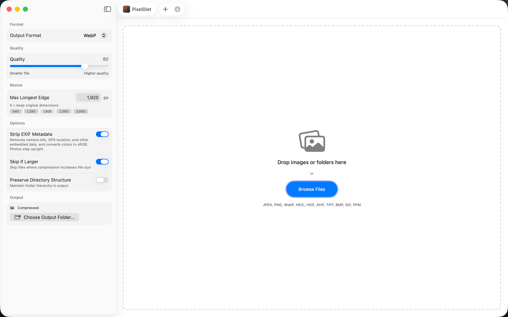
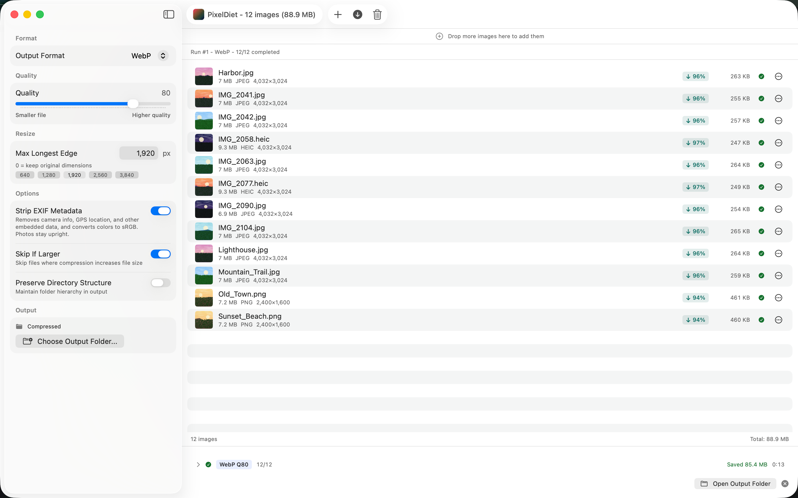
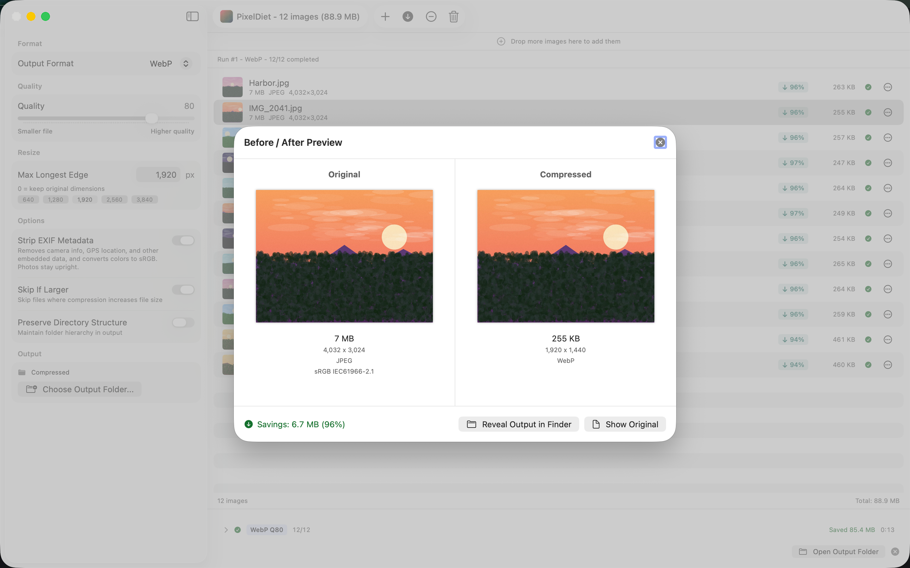

<p align="center">
  
</p>

<h1 align="center">PixelDiet</h1>

<p align="center">
  <strong>Bulk image compression for Mac - fast, native, private.</strong>
</p>

<p align="center">
  
  
  
  
</p>

---

PixelDiet is a native macOS application for batch image compression, resizing, and format conversion. Drop hundreds of images and watch them shrink - using all your CPU cores.

Built with Apple's native frameworks (ImageIO, Core Graphics, Accelerate/vImage) plus libwebp for WebP encoding - no other dependencies. Fully sandboxed, fully offline - your images never leave your Mac.

## Screenshots



*Drop zone with format, quality, resize, and metadata controls*



*12 photos compressed to WebP with per-file savings and run history*



*Before/After Preview of the original and the compressed result*

## Features

- **Drag & Drop** - Drop files or folders onto the app window
- **Batch Processing** - Process hundreds of images concurrently across all CPU cores
- **Format Conversion** - Convert between JPEG, PNG, WebP, HEIC, HEIF, AVIF, TIFF, BMP, and GIF
- **10 Input Formats** - PNG, JPEG, WebP, HEIC, HEIF, AVIF, TIFF, BMP, GIF, PPM, plus extensionless image files inside added folders (detected by content)
- **Quality Control** - Adjustable quality slider (10-100) with format-appropriate encoding
- **Smart Resize** - Max dimension (longest edge) with high-quality ImageIO downsampling, preserving aspect ratio
- **EXIF Strip** - Remove metadata by default to protect privacy (GPS, camera info) and convert colors to sRGB; turn it off to keep metadata and the original color profile, WebP included (CMYK images become sRGB)
- **Always Upright** - The EXIF orientation is applied to the pixels, so photos never come out sideways in any format
- **Transparency Aware** - Transparent images saved as JPEG, HEIC, HEIF, AVIF or BMP get a white background
- **Smart Skip** - Automatically skip files that would get larger after compression
- **Before/After Preview** - Double-click an image (or press Space) for a side-by-side comparison with file size savings
- **Remembers Your Setup** - Settings and the output folder are restored on the next launch
- **Conflict Resolution** - Per-file overwrite/rename/skip dialogs with "apply to all"
- **Undo** - Undo and Redo for removing images and Clear All
- **Background Friendly** - Batches keep full speed while the window is hidden; closing the window keeps the queue (Window ▸ PixelDiet brings it back)
- **Run History** - Per-run stats with format, quality, elapsed time, and savings breakdown
- **Directory Preservation** - Output mirrors input folder structure
- **Fully Offline** - No network access, no analytics, no tracking

## Requirements

- macOS 14.0 (Sonoma) or later
- Apple Silicon or Intel Mac (Universal Binary)

## Building from Source

1. Clone the repository:
   ```bash
   git clone https://github.com/georgekhananaev/pixel-diet.git
   cd pixel-diet
   ```

2. Open the Xcode project:
   ```bash
   open PixelDiet.xcodeproj
   ```

3. Select the **PixelDiet** scheme and your Mac as the run destination.

4. Build and run (Cmd+R).

### Tests

- **Unit tests** (`PixelDietTests`, Swift Testing) cover the compression engine, batch processing, the view model and settings persistence. They also run in CI.
- **UI tests** (`PixelDietUITests`) drive the real sandboxed app through its open panels and main journeys. They take a few minutes and take over the screen while running.
- Run everything with Cmd+U, or `xcodebuild test -project PixelDiet.xcodeproj -scheme PixelDiet -destination 'platform=macOS'`.
- App Store screenshots: `TEST_RUNNER_PIXELDIET_SCREENSHOTS=1 xcodebuild test ... -only-testing:PixelDietUITests/AppStoreScreenshots -resultBundlePath shots.xcresult`, then `xcrun xcresulttool export attachments --path shots.xcresult --output-path <folder>`.

> **Note:** Requires Xcode 26 or later (Swift 6.2 toolchain). The project uses Swift 6.2 Approachable Concurrency with MainActor default isolation.

## Architecture

PixelDiet follows MVVM with strict Swift 6.2 concurrency:

```
Views (SwiftUI)
  ↓ @Observable
ViewModels (@MainActor)
  ↓ Sendable structs (ImageTask, SettingsSnapshot)
Services (actors + nonisolated structs)
  ↓ TaskGroup parallelism
ImageIO / Core Graphics / vImage / libwebp
```

- **`@Observable` classes** stay on `@MainActor` - never cross actor boundaries
- **`Sendable` structs** (`ImageTask`, `SettingsSnapshot`) carry data to background services
- **`nonisolated` services** (`ImageCompressor`, `ImageAnalyzer`, `PathSanitizer`) run in `TaskGroup` child tasks without hopping to MainActor
- **`BatchProcessor` actor** orchestrates parallel compression with adaptive memory-budget-based concurrency
- **Memory-efficient resizing** via `CGImageSourceCreateThumbnailAtIndex` - resized images are downsampled while decoding, never loaded at full resolution

## Supported Formats

| Format | Input | Output | Quality Slider |
|--------|:-----:|:------:|:--------------:|
| JPEG   | Yes   | Yes    | Yes            |
| PNG    | Yes   | Yes    | No             |
| WebP   | Yes   | Yes    | Yes            |
| HEIC   | Yes   | Yes    | Yes            |
| HEIF   | Yes   | Yes    | Yes            |
| AVIF   | Yes   | Yes*   | Yes            |
| TIFF   | Yes   | Yes    | No             |
| BMP    | Yes   | Yes    | No             |
| GIF    | Yes   | Yes    | No             |
| PPM    | Yes   | No     | N/A            |

*AVIF output requires macOS 14.1+. Availability is checked at runtime.

## Keyboard Shortcuts

| Shortcut    | Action |
|-------------|--------|
| Cmd+O       | Add images |
| Cmd+Shift+O | Choose output folder |
| Cmd+R       | Start compression |
| Cmd+.       | Cancel compression |
| Space       | Preview selected image |
| Delete      | Remove selected images |
| Cmd+Z       | Undo Remove or Clear All |
| Cmd+,       | Settings |
| Cmd+?       | PixelDiet Help |

## Privacy

PixelDiet collects no data. It makes no network requests. All image processing happens locally on your Mac. EXIF metadata stripping is enabled by default to protect location and camera information. See the full [Privacy Policy](PRIVACY.md).

## Support

Questions, problems or feedback: see [Support](SUPPORT.md) for answers to common questions, email [george@khananaev.com](mailto:george@khananaev.com), or [open an issue](https://github.com/georgekhananaev/pixel-diet/issues).

## License

**Non-Commercial Open Source License** - see [LICENSE](LICENSE) for full terms.

You may use, study, modify, and redistribute for personal, educational, or non-commercial purposes. Commercial use, App Store distribution, and reselling are prohibited without written permission from the author.

## Author

**George Khananaev** - [LinkedIn](https://www.linkedin.com/in/georgekhananaev/)

For commercial licensing inquiries, contact via LinkedIn.
